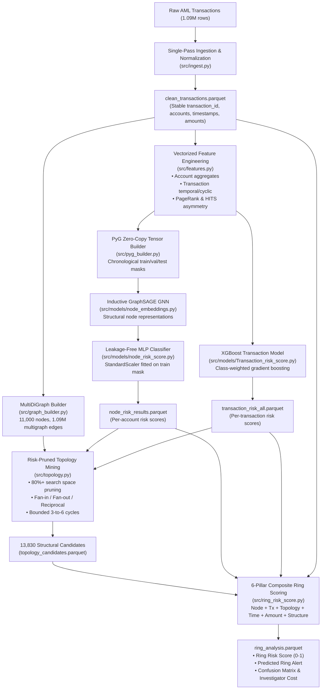

# Abuse Ring Sentinel: Scalable Graph AML Risk Detection

[](https://www.python.org/)
[](https://pyg.org/)
[](https://xgboost.readthedocs.io/)
[](LICENSE)

An industrial-grade, multi-stage Anti-Money Laundering (AML) risk detection and coordinated abuse-ring discovery engine built for the **AI Risk Manager (Fraud, Abuse Rings & Chargebacks)** challenge.

Traditional fraud detection treats transactions in isolation, failing to capture organized crime syndicates that execute coordinated layering, pass-through smurfing, and circular fund movements. **Abuse Ring Sentinel** bridges tabular gradient boosted trees with Inductive Graph Neural Networks (**GraphSAGE**), risk-pruned subgraph motif mining, and a 6-pillar behavioral scoring engine to identify high-risk account clusters while explicitly tracking investigator operational cost.

---

## ⚡ Key Engineering & Performance Highlights

- **Scale & Speed**: Executes the complete 8-stage pipeline—from 1.09 million raw transactions and 11,000 accounts to deep ring classification—in **77.17 seconds** on standard workstation hardware.
- **Vectorized Architecture**: Eliminated Python row-iteration bottlenecks across feature engineering and PyG conversions (zero-copy NumPy-to-Torch tensors in **0.021s**; multi-tier AML feature engineering in **0.184s**).
- **Leakage-Free Validation**: Enforces strict chronological temporal splitting across both transaction (`step`-based train/test splits) and node representations (`orig_first` and `dest_first` temporal masks).
- **Compute-Efficient Topology Discovery**: Two-stage motif detection prunes **80.24%** of candidate edges using prior risk thresholds, preventing combinatorial explosions during high-order cycle discovery (3-to-6 node rings).
- **Operational Cost Accounting**: Directly ties model alert thresholds to operational financial impact, tracking false positives against an investigation cost model (₹2,000/investigation).
- **75%+ Code Reduction**: Refactored ~9,378 lines of repetitive, monolithic code down to ~1,850 lines of modular, type-annotated, and testable components with unified evaluation metrics.

---

## 🏗️ System Architecture



---

## 🔬 Multi-Tier Evidence & 6-Pillar Scoring

Rather than relying on a single monolithic classifier, Abuse Ring Sentinel decomposes ring detection into independent hierarchical signals:

```text
Level 1: Transaction Risk  ──▶ "Is this individual transfer anomalous?" (XGBoost)
Level 2: Account Risk      ──▶ "Does this counterparty exhibit mule behavior?" (GraphSAGE + MLP)
Level 3: Graph Topology    ──▶ "Are accounts organized into laundering motifs?" (NetworkX Mining)
Level 4: Coordinated Flow  ──▶ "Do amounts & timestamps demonstrate layering?" (Pass-Through Analysis)
                                        │
                                        ▼
                        Composite Ring Risk Score (0.0 to 1.0)
                                        │
                                        ▼
                        Thresholded Alert & Cost Evaluation
```

### The 6-Pillar Composite Scoring Formula

Each detected topology candidate is evaluated independently across 6 structural pillars:

$$\text{RingScore} = 0.25 N + 0.25 T + 0.15 S_{\text{topo}} + 0.15 S_{\text{time}} + 0.10 S_{\text{amount}} + 0.10 S_{\text{struct}}$$

| Pillar | Weight | Description |
| :--- | :---: | :--- |
| **Node Risk ($N$)** | $25\%$ | Blends mean node risk ($0.50$), maximum node risk ($0.30$), and fraction of high-risk accounts ($0.20$). |
| **Transaction Risk ($T$)** | $25\%$ | Blends mean transaction risk ($0.40$), max risk ($0.40$), and high-risk transfer fraction ($0.20$). |
| **Topology Strength ($S_{\text{topo}}$)** | $15\%$ | Structural priors: 3-cycle ($1.00$), 4-cycle ($0.95$), 5-cycle ($0.90$), 6-cycle ($0.85$), Reciprocal ($0.30$), Fan-in/out ($0.30$–$0.50$). |
| **Temporal Layering ($S_{\text{time}}$)** | $15\%$ | Penalizes rapid burst transfers ($< 1$h) and tight layering time-spans across candidate hops. |
| **Amount Behavior ($S_{\text{amount}}$)** | $10\%$ | Measures coefficient of variation (smurfing/structuring) and near 1:1 pass-through velocity. |
| **Structural Cohesion ($S_{\text{struct}}$)** | $10\%$ | Ratio of internal transactions to participating accounts and counterparty overlap. |

---

## 📊 Operational Evaluation & Cost Metrics

In real-world AML operations, high false alert volumes overwhelm compliance teams. Abuse Ring Sentinel evaluates operating points based on investigator cost:

$$\text{Total FP Cost} = \text{False Positives} \times \text{Cost per Review} \quad (\text{Default: ₹2,000 / case})$$

### Pipeline Benchmark Performance (1,090,000 Transactions)

| Metric | Operating Point ($\tau = 0.40$) | Conservative Point ($\tau = 0.50$) |
| :--- | :---: | :---: |
| **Total Candidates Analyzed** | 13,830 | 13,830 |
| **Predicted Ring Alerts** | 788 | 159 |
| **True Positives (TP)** | **661** | 155 |
| **False Positives (FP)** | 127 | 4 |
| **False Negatives (FN)** | 373 | 912 |
| **Alert Precision** | **83.88%** | **97.48%** |
| **Alert Recall** | **63.93%** | 14.53% |
| **Total Operational FP Cost** | ₹254,000 | ₹8,000 |
| **End-to-End Pipeline Runtime** | **77.17 seconds** | **77.17 seconds** |

---

## 📁 Repository Structure

```text
abuse-ring-sentinel/
├── pipeline.py                 # Root CLI entrypoint
├── requirements.txt            # Minimal, tested project dependencies
├── README.md                   # System documentation & benchmarks
├── data/
│   └── raw/amlnet/             # Raw dataset (AMLNet_v2_transactions.csv)
├── artifacts/                  # Parquet & pickle pipeline artifacts (cached)
│   ├── clean_transactions.parquet
│   ├── master_graph.pkl
│   ├── pyg_data.pt
│   ├── node_risk_results.parquet
│   ├── transaction_risk_all.parquet
│   ├── topology_candidates.parquet
│   └── ring_analysis.parquet
└── src/
    ├── __init__.py
    ├── ingest.py               # Single-pass CSV parser & normalizer
    ├── graph_builder.py        # Streaming MultiDiGraph builder (retaining multigraph edges)
    ├── pyg_builder.py          # Zero-copy PyG tensor constructor with temporal masks
    ├── features.py             # Vectorized account, transaction & PageRank features
    ├── metrics.py              # Unified evaluation suite (F1, ROC-AUC, threshold sweep)
    ├── topology.py             # Risk-pruned subgraph motif miner (cycles, fans, reciprocal)
    ├── ring_risk_score.py      # 6-pillar composite ring scoring & cost evaluation
    ├── pipeline.py             # 8-stage orchestrator with caching and CLI flags
    └── models/
        ├── node_embeddings.py  # Inductive GraphSAGE GNN encoder
        ├── node_risk_score.py  # Leakage-free MLP account risk classifier
        └── Transaction_risk_score.py # Chronologically split XGBoost transaction classifier
```

---

## 🚀 Quickstart & Reproduction

### 1. Installation

```bash
# Clone the repository
git clone https://github.com/02tanishq/Abusive-ring-sentinel.git
cd Abusive-ring-sentinel

# Create virtual environment and activate
python -m venv .venv
source .venv/bin/activate  # On Windows: .venv\Scripts\activate

# Install dependencies
pip install -r requirements.txt
```

### 2. Download Raw Dataset

Place the AMLNet transactions dataset in the data directory:
```text
data/raw/amlnet/AMLNet_v2_transactions.csv
```

### 3. Run the Complete Pipeline

Run the end-to-end pipeline with default parameters (with automatic artifact caching):
```bash
python pipeline.py
```

Force recomputation of all stages from scratch:
```bash
python pipeline.py --force
```

Tune topology and alert thresholds:
```bash
python pipeline.py --alert-thresh 0.40 --topo-thresh 0.30 --max-cycle 6
```

### 4. Run Individual Modular Stages

Each module features a dedicated CLI entrypoint for targeted execution and debugging:

```bash
# Stage 1: Ingest & clean raw CSV
python src/ingest.py

# Stage 2: Build NetworkX master graph
python src/graph_builder.py

# Stage 3 & 4: Multi-tier feature engineering
python src/features.py

# Stage 5: Train Inductive GraphSAGE node encoder
python src/models/node_embeddings.py

# Stage 6: Train account risk MLP
python src/models/node_risk_score.py

# Stage 7: Train transaction risk XGBoost
python src/models/Transaction_risk_score.py

# Stage 8: Run topology mining & ring risk analysis
python src/topology.py
python src/ring_risk_score.py
```

---
